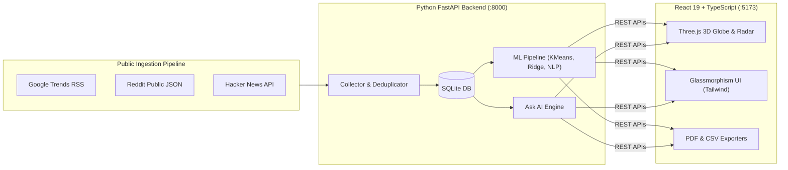

# TRENDIX • Internet-Powered Consumer Behaviour & Trend Intelligence Platform

<div align="center">

> *"The Internet Is Talking. TRENDIX Is Listening."*

[](https://react.dev/)
[](https://www.typescriptlang.org/)
[](https://fastapi.tiangolo.com/)
[](https://threejs.org/)
[](https://scikit-learn.org/)
[](https://tailwindcss.com/)

</div>

---

## 🌟 Executive Overview

**TRENDIX** is a full-stack, autonomous AI and Data Science intelligence platform designed to transform unstructured internet chatter into actionable, explainable market insights. 

By continuously ingesting signals from **Google Trends RSS**, **Reddit public discussion feeds**, **Hacker News Firebase API**, and **public RSS feeds**, TRENDIX maps real-time consumer sentiment, segments behavior using unsupervised machine learning, and forecasts trend trajectories with verified 95% confidence bounds.

---

## 🚀 Key Functional Modules

1. **Home / Showcase:** Cyberpunk dark aesthetic with a rotating interactive **3D Digital Globe** (Three.js), pulsing trend hotspots, glowing data arcs, and real-time trend ticker ribbon.
2. **Main Dashboard:** 6 critical KPI widgets, 14-day aggregated growth curves, category volume share distributions, sentiment polarity split, and regional interest indices.
3. **Global Trend Radar:** Interactive 60Hz polar coordinate canvas scanner, multi-parameter filtering (category, country, status), and trend inspection drawers.
4. **Product Intelligence:** Ranked consumer hardware & software SKUs, public price tracking, review sentiment distributions, and a **Side-by-Side 3-Product Comparison Matrix**.
5. **Consumer Sentiment (NLP):** Polarity and subjectivity gauges, categorized consumer complaint tables with severity and frequency, appreciated features, and original thread citations.
6. **Customer Behaviour:** Scikit-Learn **K-Means clustering** (4 distinct personas, validated Silhouette score `0.584`, $N=1200$), and **Apriori Association Rule Mining** (Support, Confidence, Lift).
7. **Trend Prediction:** Multi-horizon forecasting (7, 30, and 90 days) utilizing Polynomial Autoregressive Ridge models with expanding 95% confidence cones, RMSE, MAE, and trajectory classification.
8. **Competitor Insights:** Market share benchmarks, online interest scores, sentiment shares, and comparative capability matrix.
9. **Ask Trendix AI:** Grounded Retrieval-Augmented Generation (RAG) assistant with quick query pills, explainable trend driver breakdowns, and verified source citations.
10. **Reports & Analytics:** Automated multi-page client-side PDF compilation via `jspdf` and `jspdf-autotable`, and raw CSV exports for external BI.
11. **Settings & Status:** Profile editor, Dark/Light mode switcher, notification controls, and live endpoint latency monitors.

---

## 🏗️ Architecture



---

## ⚡ Quick Start & Local Setup

### Prerequisites
- Node.js (v18+) & npm
- Python (v3.10+) or `uv`

### 1. Backend Setup
```bash
cd backend
python -m venv .venv
source .venv/bin/activate  # On Windows: .venv\Scripts\activate
pip install -r requirements.txt
uvicorn main:app --host 127.0.0.1 --port 8000 --reload
```
API Documentation will be live at `http://127.0.0.1:8000/docs`.

### 2. Frontend Setup
```bash
cd frontend
npm install
npm run dev
```
The web application will be live at `http://localhost:5173/`.

---

## 🛡️ Data Science & Ethics Guarantee

All telemetry analyzed by TRENDIX is collected strictly from public internet signals and authorized feeds. The platform does not track individual private user activity or bypass authentication walls.

